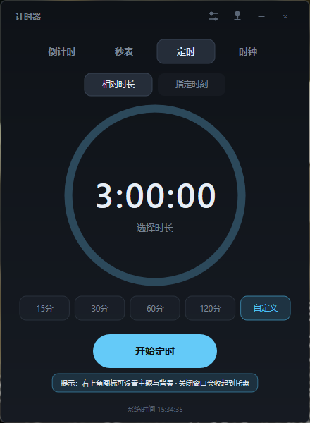
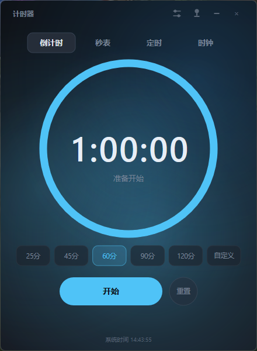
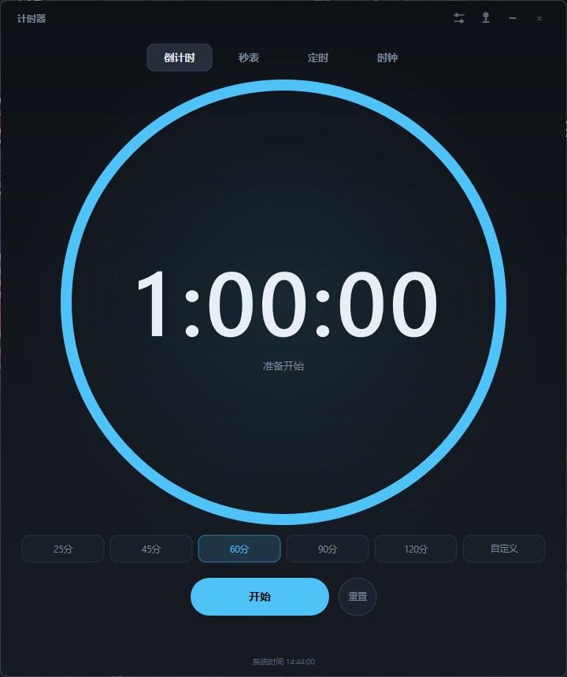

# 计时器 · Exam Timer

[](https://github.com/cy-whm/exam-timer/actions/workflows/build.yml)
[](https://github.com/cy-whm/exam-timer/releases)


原生 Windows 桌面计时器，面向**模拟考试、番茄钟、定时提醒**等场景。C++17 + Win32 + Direct2D 实现，**单文件 exe（约 340 KB）**，双击即用——不依赖 .NET、Python、Electron 任何运行时。

> A native Windows timer (countdown / stopwatch / alarm / clock) written in C++17 with Win32 + Direct2D.
> Single portable executable, zero runtime dependencies, no installer.

## 特性

| 模式 | 说明 |
|---|---|
| **倒计时** | 25 / 45 / 60 / 90 / 120 分钟预设，或点「自定义」用 ▲▼ 设任意小时/分钟（1 分钟 ~ 24 小时）；圆环随剩余时间收缩；最后 15%（最多 60 秒）转橙色告警；归零变红并提醒 |
| **秒表** | 显示到 **1/100 秒**；**计次（Lap）**：按「计次」或键盘 `L` 记录分段，状态行实时显示本轮分段；「计次记录」查看全部记录（可滚动）；三档音效：关 → 嘀嗒 → 快速嗒嗒 |
| **定时** | ① 相对时长 15 / 30 / 60 / 120 分钟，或「自定义」任意时长；② 指定时刻 `HH:MM`（已过点自动顺延到明天） |
| **时钟** | 当前时间 + 日期 + 星期；可切换 **Windows 全部约 140 个时区**，含夏令时规则，纯离线 |

其他：

- **到点提醒**：提示音 + 系统托盘气泡 + 任务栏图标闪烁
- **托盘悬停显示剩余时间**（如「倒计时 剩余 23:15」），不必把窗口调出来
- **关闭窗口 = 收起到托盘继续计时**（可关闭该行为）；托盘双击恢复、右键菜单可置顶/退出
- **单实例**：再次双击只唤醒已有窗口，不会跑出两个计时器
- 窗口可缩放（380×520 起），布局、圆环、字号全部自适应；尺寸与位置会被记住
- 窗口置顶开关；计时期间阻止系统睡眠/熄屏
- **6 套配色主题**（含浅色）、**极光动态背景**、**自定义图片背景**
- 配置便携：写在 exe 同目录的 `settings.ini`；目录不可写时回退 `%APPDATA%\ExamTimer`

## 界面

| 倒计时 | 秒表（含计次） | 定时（自定义时长） |
|---|---|---|
|  |  |  |

| 时钟与时区 | 外观设置 | 主题：樱粉 |
|---|---|---|
|  |  |  |

| 极光动态背景 | 自定义图片背景 | 大尺寸自适应 |
|---|---|---|
|  |  |  |

更多截图见 [`shots/`](shots/) 目录。

## 下载与运行

1. 到 [Releases](../../releases) 下载附件 `Timer-vX.Y.Z-win64.exe`（Release 资产用 ASCII 名，避免各平台下载时的编码问题）
2. 改名为 `计时器.exe`（可选，程序不依赖文件名），双击运行（Windows 10 1607+ / Windows 11，x64）
3. 绿色便携：不需要安装，删掉文件即卸载

也可以不用 Release，直接按下方「从源码构建」自己编译。

**首次运行可能被 Windows 拦下**：本程序没有购买代码签名证书，属于「未知发布者」。两种情况处理方式不同：

| 提示 | 处理 |
|---|---|
| SmartScreen「Windows 已保护你的电脑」 | 点「更多信息」→「仍要运行」，同一文件放行一次后不再提示 |
| Defender「检测到威胁 / 操作无法完成」 | 安全中心 → 保护历史记录 → 允许；或把所在目录加入排除项 |

长期方案：加 Defender 排除项、向[微软提交误报](https://www.microsoft.com/en-us/wdsi/filesubmission)、或使用代码签名证书。
注意每次重新编译都会产生新哈希、信誉清零，可能再次提示。

## 快捷键

| 按键 | 作用 |
|---|---|
| `空格` | 开始 / 暂停（定时模式为取消定时） |
| `L` | 秒表计次 |
| `Esc` | 关闭设置面板 → 关闭计次记录 → 关闭时区列表 → 退出编辑 → 最小化 |

## 计时准确性（这是本项目最在意的部分）

程序内部使用两套时钟，这是考试计时正确性的关键：

| 用途 | 时钟 | 原因 |
|---|---|---|
| 倒计时 / 秒表 | 单调时钟（`steady_clock` / QPC） | 系统校时、手动改时间、夏令时切换都不会让计时多算或少算 |
| 定时到点（`HH:MM`） | 设置瞬间把墙钟目标换算成单调截止点 | 设定之后即使系统时间被调整，到点时刻也不会漂移 |

举例：如果全程用系统时间做减法，考试中途遇到夏令时切换，2 小时的倒计时会变成 1 小时或 3 小时。

**为什么不同步网络时间**：Windows 时间服务本身已通过 NTP 自动校时，系统时间就是可靠基准。程序只读取系统时间，不自行发包连接授时服务器——避免网络依赖与防火墙问题。时区显示同样完全离线，数据来自 Windows 内置时区库。

## 技术说明

- **UI**：Direct2D + DirectWrite 硬件加速绘制；数字按字形宽度等分单元格居中绘制，秒级跳动时不会左右抖动；大号数字按可用空间动态计算字号并缓存字体
- **计时**：单实例 + 单调时钟 + 16/250 ms 自适应重绘（仅在需要动画时跑 60fps）
- **背景**：渐变用线性渐变笔刷；极光用 3 团径向光晕按正弦轨迹漂移（约 25fps，仅窗口可见时重绘）；图片用 WIC 解码成 `ID2D1Bitmap`，cover 裁剪后叠渐变蒙版保证可读性
- **音效**：不是外部音频文件，而是启动时按公式生成的 16bit/44.1kHz 波形（正弦基音 + 低频体 + 起音噪声，指数衰减），tick/tock 两种音高交替
- **为什么不用 Electron / Tauri / .NET**：这个工具的核心诉求是"秒开、常驻、不占资源"。Electron 起步 100MB+ 且要装运行时；C++ 原生方案编译产物 340KB、冷启动几乎瞬时、无任何依赖

## 从源码构建

需要 **Visual Studio 2022**（C++ 桌面工作负载）+ **CMake 3.20+**：

```powershell
cmake -S . -B build -G "Visual Studio 17 2022" -A x64
cmake --build build --config Release
# 产物：build/Release/Timer.exe（可自行改名为 计时器.exe）
```

图标由 `tools/make_icon.ps1` 生成到 `res/app.ico`（多尺寸 PNG-in-ICO）。

CI 见 [`.github/workflows/build.yml`](.github/workflows/build.yml)：每次 push 到 `main` 会在 `windows-latest` 上构建并上传 artifact。

## 项目结构

```
src/
  main.cpp     窗口、消息循环、托盘、热键、单实例、音效合成
  app.cpp      主题表与调色板、时间与时区、配置读写
  render.cpp   Direct2D 渲染层（圆环、文字、大号数字、背景、图片解码）
  ui.cpp       布局与界面绘制（四种模式 + 设置面板 + 提示气泡）
  *.h          对应头文件
res/           图标、应用清单、资源脚本
tools/         开发辅助：图标生成、窗口矩形查询、UI 自动化点击、截图脚本
shots/         界面截图
```

## 已知限制

- 只支持 Windows x64（Win32 API + Direct2D）
- 自定义图片不做裁剪预览，直接按窗口比例居中裁剪
- 动态背景只做程序化极光，不含视频/GIF 播放
- 提醒依赖系统通知设置：若系统关闭通知或开启专注助手，托盘气泡可能不显示（此时仍有提示音和任务栏闪烁）
- 主题色是预设的 6 套，暂不支持自定义取色

## 开发参数

```powershell
Timer.exe --seconds 8              # 直接以 8 秒倒计时启动（验证提醒流程）
Timer.exe --theme 3                # 启动时指定主题（0-5）
Timer.exe --backdrop 1             # 背景：0 渐变 / 1 极光 / 2 图片
Timer.exe --image D:\bg.jpg        # 指定背景图（配合 --backdrop 2）
Timer.exe --size 720x860           # 指定窗口尺寸（DIP）
Timer.exe --dumptick D:\tmp        # 导出生成的嘀嗒声 wav（检查波形用）
$env:EXAMTIMER_INI='D:\tmp\x.ini'  # 强制指定配置文件路径
```

## 许可证

[MIT](LICENSE) © 2026 Hanming Wang
