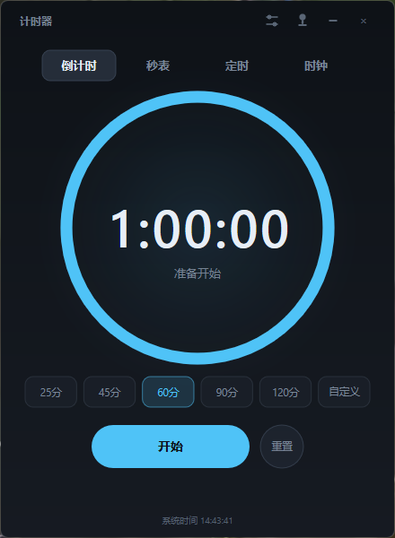
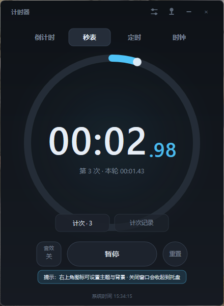
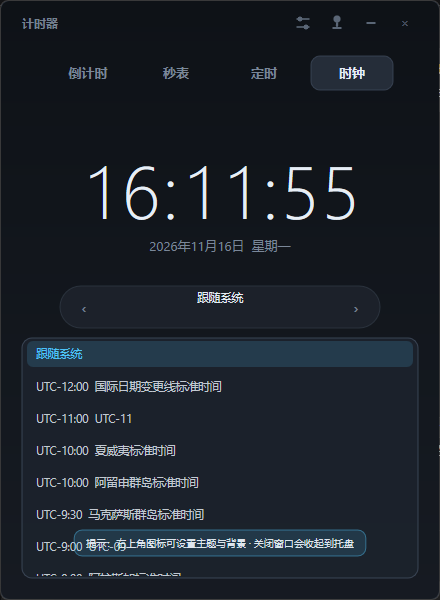
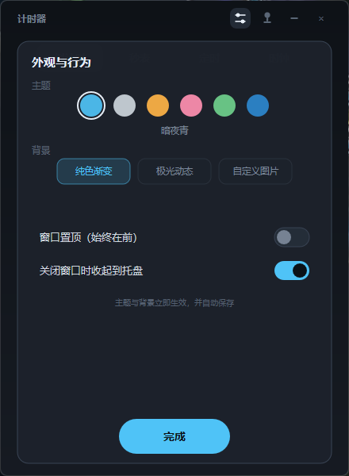
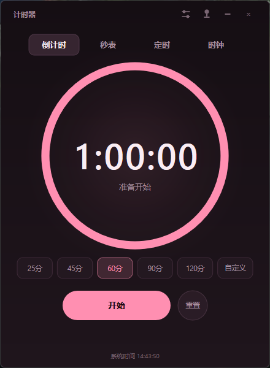
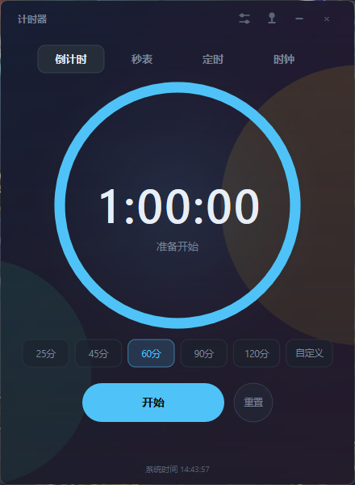

# 计时器 Exam Timer

一个原生 Windows 桌面计时工具，面向模拟考试、番茄钟、定时提醒等场景。

- **单文件 exe，约 300 KB**，双击即用，无需安装、无需运行时（不依赖 .NET / Python / Electron）
- Direct2D 硬件加速绘制，圆环进度平滑动画，窗口与字号随尺寸自适应
- 计时基于**单调时钟**，不受系统校时、夏令时切换、手动改时间影响
- **6 套配色主题**（含浅色）、**动态极光背景**、**自定义背景图**

## 界面

| 倒计时 | 秒表（含计次） | 定时（自定义时长） |
|---|---|---|
|  |  |  |

| 时钟与时区 | 外观设置 | 主题：樱粉 |
|---|---|---|
|  |  |  |

| 极光动态背景 | 自定义图片背景 | 大尺寸自适应 |
|---|---|---|
|  |  |  |

更多截图见 `shots/` 目录。

## 功能

| 模式 | 说明 |
|---|---|
| **倒计时** | 25 / 45 / 60 / 90 / 120 分钟预设；点「自定义」可用 ▲▼ 调整任意小时/分钟（最长 24 小时）；圆环随剩余时间收缩；最后 15%（最多 60 秒）转橙色告警；归零变红并提醒 |
| **秒表** | 正计时，显示到 **1/100 秒**（百分秒）；**计次（Lap）**：按「计次」或键盘 `L` 记录分段，显示本轮分段与总时间；「计次记录」可查看全部记录（可滚动）；「开始」左侧有**音效按钮**，三档循环：关 → 嘀嗒（每秒 tick-tock）→ 快速嗒嗒（每秒 8 声） |
| **定时** | ① 相对时长 15 / 30 / 60 / 120 分钟，或点「自定义」用 ▲▼ 设定任意小时/分钟；② 指定时刻 `HH:MM`（已过点自动顺延到明天） |
| **时钟** | 当前时间 + 日期 + 星期；可切换 **Windows 全部约 140 个时区**，含夏令时规则，纯离线 |

公共能力：

- **到点提醒**：提示音 + 系统托盘气泡 + 任务栏图标闪烁
- **托盘图标悬停显示剩余时间**（如「倒计时 剩余 23:15」），不用把窗口调出来
- **关闭窗口 = 收起到托盘继续计时**（可在设置里关掉）；托盘双击恢复、右键菜单可置顶/退出
- **窗口可缩放**（380×520 起），布局、圆环、字号自动适配；尺寸会被记住
- **窗口置顶**开关（标题栏图钉或托盘菜单）
- 计时期间**阻止系统睡眠 / 关闭显示器**
- 自动记住：窗口位置与尺寸、主题、背景、上次模式、时区、时长

## 个性化

点标题栏的设置图标打开「外观与行为」（鼠标悬停在图标上会显示说明）：

| 项目 | 选项 |
|---|---|
| 主题 | 暗夜青 / 石墨 / 暖阳 / 樱粉 / 森野 / 晨光（浅色） |
| 背景 | 纯色渐变 / 极光动态（程序生成、缓慢漂移）/ 自定义图片（本地 PNG·JPG·BMP·GIF，自动裁剪填满并加暗色蒙版保证可读） |
| 行为 | 窗口置顶、关闭时收起到托盘 |

**秒表的音效**：「开始」左侧的方形按钮，点一下循环切换三档（悬停有说明，状态会记住）：

| 档位 | 效果 |
|---|---|
| 关 | 无声 |
| 嘀嗒 | 每秒一声，tick / tock 两种音高交替（1950Hz / 1340Hz） |
| 快速 | 每秒 8 声短促"嗒"（2600Hz，28ms），接近机械秒表擒纵声 |

声音不是外部音频文件，而是启动时按公式生成的 16bit/44.1kHz 波形——正弦基音 + 低频体 + 起音噪声，指数衰减。选百分秒而不是千分秒是刻意的：界面 60fps 下每帧约 16ms，三位毫秒会糊成噪声，两位在 60fps 下刚好平滑，实体秒表也是 1/100 秒精度。

所有选择**立即生效并立即写盘**（点击后约 0.8 秒落盘，另外关闭、退出、移动/缩放窗口时也会保存）。

**配置保存在哪里**：优先 `计时器.exe` 同目录的 `settings.ini`（便携模式，拷走文件夹即带配置）；若该目录不可写（例如放在 `Program Files`），自动回退到 `%APPDATA%\ExamTimer\settings.ini`。设置面板底部会显示实际使用的路径。

## 首次运行被 Windows 拦下？

本程序没有购买代码签名证书，属于「未知发布者」。Windows 可能提示以下两类，处理方式不同：

| 提示 | 处理 |
|---|---|
| SmartScreen「Windows 已保护你的电脑」 | 点「更多信息」→「仍要运行」。同一个 exe 放行一次后不再提示 |
| Defender「检测到威胁 / 操作无法完成」 | 打开「Windows 安全中心 → 病毒和威胁防护 → 保护历史记录」→ 允许该文件；或添加排除项目录 |

长期方案（任选其一）：

1. 加排除项（管理员 PowerShell 执行一次，把路径改成实际位置）：
   ```powershell
   Add-MpPreference -ExclusionPath "D:\你的目录\dist"
   ```
2. 提交误报到微软：<https://www.microsoft.com/en-us/wdsi/filesubmission>
3. 使用代码签名证书签名（自签名需把证书导入「受信任的根证书颁发机构」才生效；购买 OV/EV 证书可彻底消除提示）

> 注意：每次重新编译都会产生新的文件哈希，信誉清零，所以重新编译后可能再次提示。

## 快捷键

| 按键 | 作用 |
|---|---|
| `空格` | 开始 / 暂停（定时模式为取消定时） |
| `L` | 秒表计次（记一段） |
| `Esc` | 关闭设置面板 → 关闭计次记录 → 关闭时区列表 → 退出编辑 → 最小化窗口 |

## 使用

1. 双击 `计时器.exe`
2. 顶部切换四个模式：倒计时 / 秒表 / 定时 / 时钟
3. 拖动顶部空白区域移动窗口；拖窗口边缘缩放；右上角依次为 设置、置顶、最小化、关闭（鼠标悬停有文字提示）
4. 关闭后程序仍在托盘里继续计时；**再次双击只会唤起已有窗口，不会开出第二个计时器**（单实例）

## 技术说明

**为什么计时不用系统时间做减法**

程序内部使用两套时钟，这是考试计时正确性的关键：

| 用途 | 时钟 | 原因 |
|---|---|---|
| 倒计时 / 秒表 | 单调时钟（`steady_clock` / QPC） | 系统校时、手动改时间、夏令时切换都不会让计时多算或少算 |
| 定时到点（`HH:MM`） | 设置瞬间把墙钟目标换算成单调截止点 | 同上；设定后即使系统时间被调整，到点时刻也不会漂移 |

举例：如果全程用系统时间做减法，考试中途遇到夏令时切换，2 小时的倒计时会变成 1 小时或 3 小时。

**为什么不同步网络时间**

Windows 时间服务本身已通过 NTP 自动校时，系统时间就是可靠基准。程序只读取系统时间，不自行发包连接授时服务器——避免网络依赖与防火墙问题。时区显示同样完全离线，数据来自 Windows 内置时区库。

**渲染**

C++17 + Win32 + Direct2D / DirectWrite。数字采用字形宽度等分单元格居中绘制，秒级跳动时不会左右抖动；大号数字按可用空间动态计算字号与缓存字体。

**背景**

渐变用 `ID2D1LinearGradientBrush`；极光用 3 团径向渐变光晕按正弦轨迹缓慢漂移（约 25fps，仅在可见时重绘）；图片用 WIC 解码成 `ID2D1Bitmap`，按 cover 方式裁剪后叠加渐变蒙版。

## 从源码构建

需要 Visual Studio 2022（C++ 桌面工作负载）+ CMake：

```powershell
cmake -S . -B build -G "Visual Studio 17 2022" -A x64
cmake --build build --config Release
# 产物：build/Release/Timer.exe
```

图标由 `tools/make_icon.ps1` 生成到 `res/app.ico`。

## 目录结构

```
src/        源码（main.cpp 窗口与消息、app.cpp 主题与计时逻辑、render.cpp 绘制与背景、ui.cpp 布局与界面内容）
res/        图标 app.ico、清单 app.manifest、资源脚本 app.rc
tools/      开发辅助：图标生成、窗口矩形查询、UI 自动化点击、截图脚本
shots/      界面截图
```

## 已知限制

- 提醒依赖系统通知设置：若系统关闭了通知或开启了专注助手，气泡可能不显示（此时仍有提示音与任务栏闪烁）
- 自定义图片不做缩放裁剪预览，直接按窗口比例居中裁剪
- 动态背景只做程序化极光，不含视频/GIF 播放

## 开发者参数

```powershell
Timer.exe --seconds 8              # 直接以 8 秒倒计时启动（验证提醒流程）
Timer.exe --theme 3                # 启动时指定主题（0-5）
Timer.exe --backdrop 1             # 背景：0 渐变 / 1 极光 / 2 图片
Timer.exe --image D:\bg.jpg        # 指定背景图（配合 --backdrop 2）
Timer.exe --size 720x860           # 指定窗口尺寸（DIP）
Timer.exe --dumptick D:\tmp        # 导出生成的嘀嗒声 wav（检查波形用）
$env:EXAMTIMER_INI='D:\tmp\x.ini'  # 强制指定配置文件路径（测试用）
```
